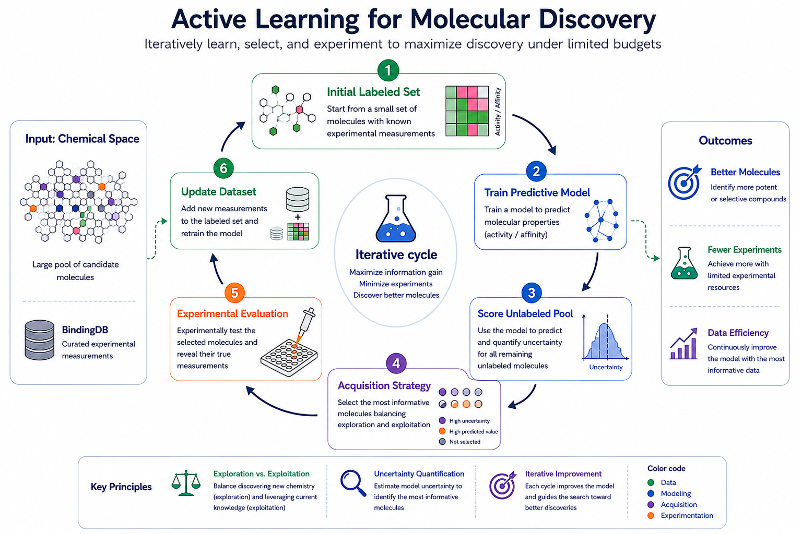
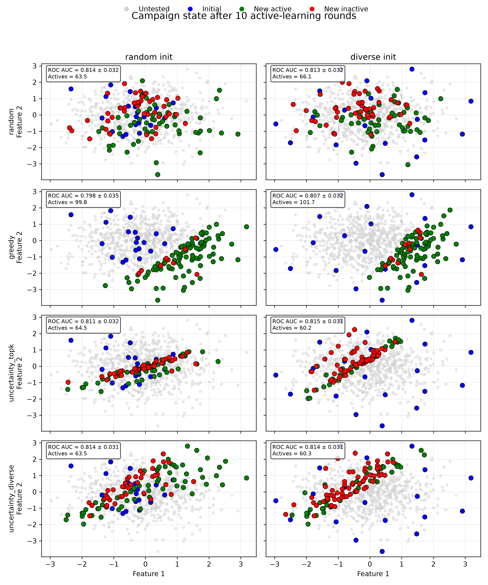
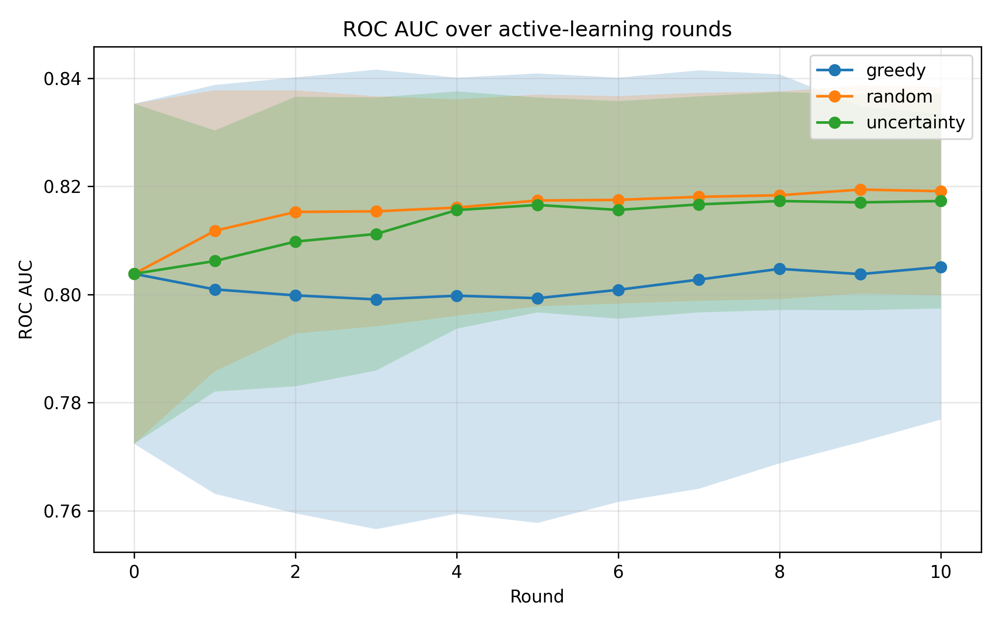
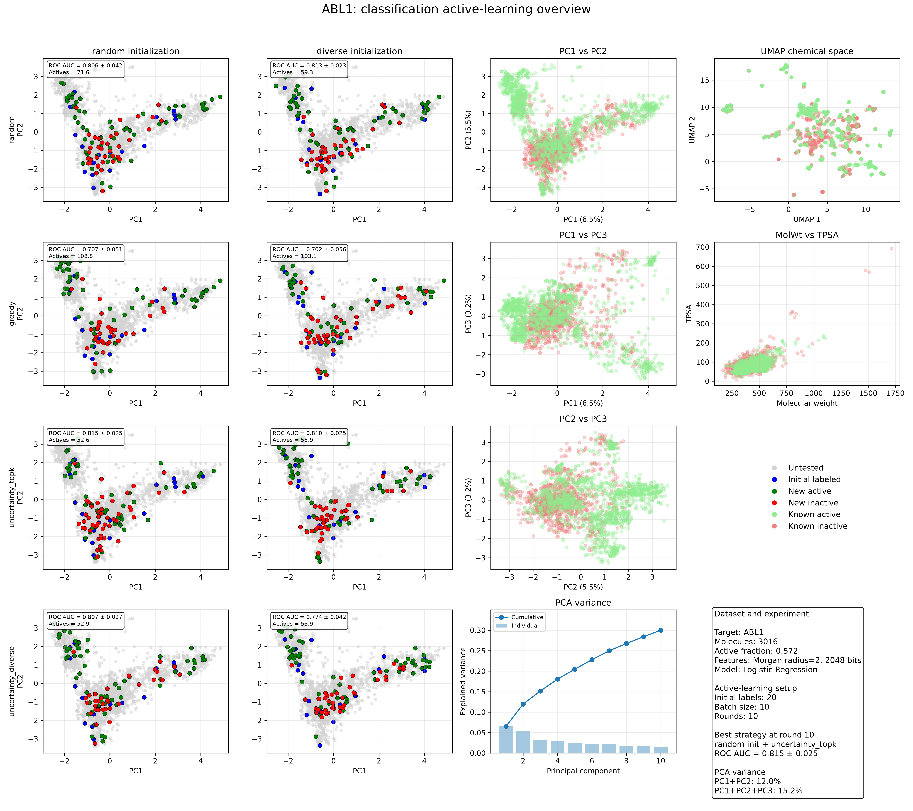
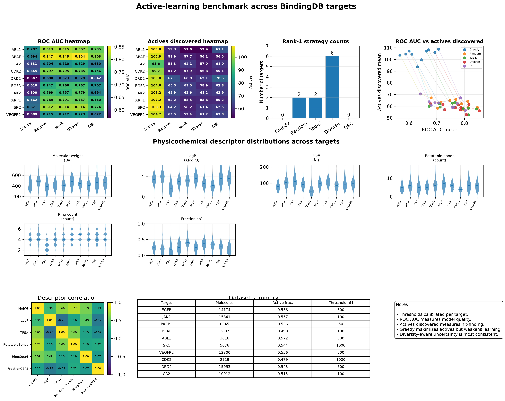
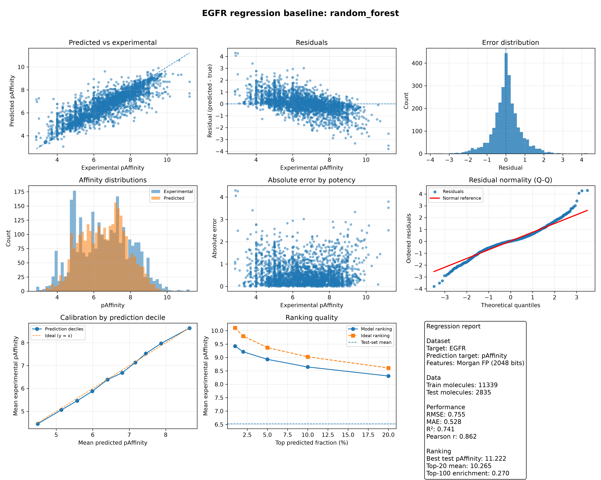
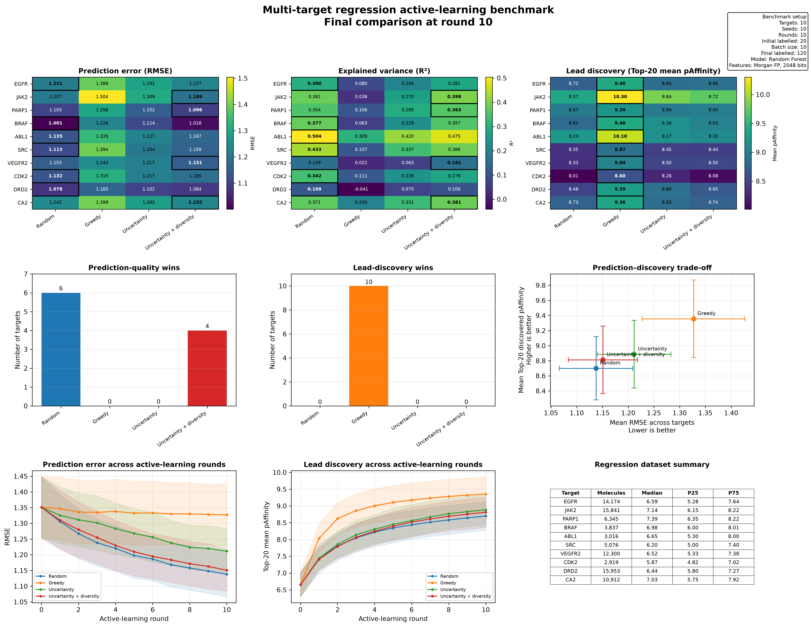

# Drug Discovery through Active Learning

> **A modular framework for studying iterative molecular discovery under constrained experimental budgets.**

---

## Overview

This repository implements a modular framework for investigating active learning in molecular discovery through retrospective simulations on curated BindingDB datasets.

Starting from binary activity classification, extending through continuous
affinity prediction with uncertainty, and now supporting multi-objective
molecular prioritisation, the project explores how acquisition strategies,
predictive models, uncertainty estimation and molecular representations
influence sequential experimental design.

Rather than presenting a single optimized pipeline, the framework has been developed incrementally. Each methodological extension addresses a limitation identified in the previous implementation, allowing new ideas to be evaluated in isolation before becoming part of the complete workflow.

Current capabilities include:

- Binary activity classification
- Continuous affinity prediction
- Multiple acquisition strategies
- Uncertainty-aware active learning
- Multi-target benchmarking
- Modular evaluation pipelines
- Modular surrogate-model interface
- Eight interchangeable regression models
- Upper Confidence Bound acquisition
- Comparative regression benchmarking
- Multi-objective affinity, QED and diversity-aware prioritisation

The long-term objective is to provide a transparent and extensible framework for studying decision-making under constrained experimental budgets while progressively extending the workflow toward closed-loop molecular discovery.

---

# Motivation

Machine learning has become an important component of modern drug discovery. Predictive models are routinely used to prioritize compounds, estimate biological activity and support medicinal chemistry campaigns. Yet the limiting resource is rarely computational—it is experimental.

Every affinity measurement requires laboratory time, specialized equipment and financial investment. Consequently, only a small fraction of the accessible chemical space can ever be explored experimentally. The central challenge therefore shifts from evaluating every possible molecule to deciding **which experiments are most worth performing**.

Traditional supervised learning assumes that all experimental labels are available before model development begins. Drug discovery rarely follows this paradigm. Instead, computational models and experimental campaigns evolve together: newly acquired measurements improve the predictive model, while the updated model guides the selection of future experiments.

Active learning formalizes this iterative process by introducing acquisition strategies that determine which compounds should be experimentally characterized next.

This repository investigates that problem through a modular framework for retrospective active-learning simulations using curated BindingDB datasets.

Rather than pursuing increasingly sophisticated algorithms from the outset, the framework progresses through successive methodological extensions, each motivated by a specific scientific question. The objective is therefore not only to compare acquisition strategies, but to understand how different methodological choices influence iterative molecular discovery.

---

# Objectives

The repository provides a modular framework for investigating active learning in molecular discovery.

Current developments include:

• investigate exploration–exploitation trade-offs;

• compare acquisition strategies;

• benchmark uncertainty-aware surrogate models;

• study molecular discovery under limited experimental budgets;

• provide an extensible research framework.

The project is intended as a research framework rather than a production-ready virtual screening platform. Emphasis is placed on reproducibility, transparency and controlled methodological comparisons.

---

# Guiding principles

Development follows three complementary principles.

### Incremental development

Methodological complexity is introduced progressively.

Simple implementations establish reference behaviour before additional components are incorporated. Every extension is motivated by a limitation identified in the previous implementation, allowing individual design choices to be evaluated independently before becoming part of the complete workflow.

### Validation-driven development

Architectural refactoring and methodological extensions are systematically validated before serving as the basis for further development.

Synthetic benchmarks, repeated simulations and behavioural equivalence tests ensure that observed performance differences originate from scientific modifications rather than implementation artefacts.

### Modular architecture

The workflow separates molecular representations, predictive models, acquisition strategies, simulation engines and evaluation metrics into independent modules.

This organization allows individual components to evolve without redesigning the overall framework, facilitating reproducibility and future methodological extensions.

---

# Data source

The framework relies on experimentally measured protein–ligand interactions extracted from **BindingDB**.

Its combination of experimentally determined affinities, diverse therapeutic targets and publicly available annotations makes it particularly suitable for retrospective active-learning studies.

The datasets used throughout this repository originate from a dedicated curation pipeline developed separately from this project. That workflow standardizes molecular representations, resolves inconsistent affinity measurements and produces reproducible target-specific datasets suitable for machine-learning experiments.

Keeping data curation independent from methodological development allows both projects to evolve separately while maintaining reproducibility.

---

# Retrospective active-learning simulations

Prospective active-learning campaigns require iterative laboratory experiments and are therefore costly and time consuming.

The framework instead adopts retrospective simulations, where experimentally measured affinities are already available but are progressively revealed following the selected acquisition strategy.

Although retrospective simulations cannot replace prospective validation, they provide a controlled environment in which different acquisition strategies can be compared under identical experimental conditions, eliminating variability introduced by independent laboratory campaigns.

---

# Workflow

The framework reproduces the iterative process underlying an active-learning campaign.

**Figure – Workflow overview**


Starting from an initial labelled dataset, a predictive model is trained and used to score the remaining candidate compounds.

An acquisition strategy then selects the next batch of molecules for experimental evaluation. The newly acquired measurements are incorporated into the training dataset, the model is retrained, and the cycle repeats until the experimental budget is exhausted.

This modular organization allows molecular representations, predictive models and acquisition strategies to be combined interchangeably while preserving a common simulation workflow.

---

# Classification framework

Binary activity prediction provides the initial environment used to investigate acquisition strategies.

Although continuous affinity prediction more closely reflects medicinal chemistry, classification isolates the behaviour of different acquisition policies before introducing additional modelling complexity.

The current framework includes:

- Random acquisition
- Greedy acquisition
- Uncertainty sampling
- Diversity-aware uncertainty
- Query by Committee

These strategies span different exploration–exploitation trade-offs while remaining sufficiently simple to analyse in controlled settings.

## Synthetic benchmarks

Acquisition strategies are first evaluated on synthetic datasets whose geometry is completely known.

This controlled environment makes it possible to attribute observed behaviour directly to the acquisition strategy itself before transferring the methodology to realistic molecular datasets.

**Figure – Toy acquisition benchmark**



The synthetic benchmark highlights clear differences in exploration behaviour among acquisition strategies despite relatively small differences in predictive performance after multiple acquisition rounds.

**Key observation**

Active-learning strategies differ primarily in the information they acquire rather than in the predictive performance ultimately achieved by the classifier.

---

## Molecular benchmarks

The same acquisition strategies are subsequently evaluated on curated BindingDB targets.

**Figure – ABL1 benchmark**


Real molecular datasets introduce substantially greater complexity than synthetic benchmarks. Molecular fingerprints provide only a partial representation of chemical space, while experimentally measured affinities introduce additional variability.

Nevertheless, acquisition strategies continue to generate distinct exploration patterns that closely resemble those observed in synthetic datasets.

Extending the analysis across multiple therapeutic targets demonstrates that no acquisition strategy consistently dominates every evaluation criterion.

**Figure – Multi-target classification benchmark**


Greedy acquisition generally retrieves the largest number of active compounds, whereas diversity-aware uncertainty provides a more balanced compromise between predictive performance and exploration.

**Key observation**

Different acquisition strategies optimize different scientific objectives. Their suitability therefore depends on the experimental question rather than on a single evaluation metric.

---

# Regression framework

Binary classification inevitably discards information contained in experimental affinity measurements.

The regression framework extends the methodology toward continuous affinity prediction while preserving the modular active-learning architecture established for classification.
Unlike classification, regression retains the quantitative information contained in experimental affinity measurements. This enables acquisition strategies to prioritize compounds according to both expected potency and predictive uncertainty, transforming active learning into a sequential optimization problem rather than a binary classification task.

Current developments include:

- continuous affinity prediction;
- uncertainty-aware acquisition;
- Upper Confidence Bound optimization;
- repeated simulations;
- target-wise benchmarking.

### Regression surrogate models

The regression workflow is built around a common surrogate-model interface that
allows different regression algorithms to be evaluated under identical
active-learning campaigns.

Current implementations include:

- Linear Regression
- Bayesian Ridge
- Random Forest
- Extra Trees
- Gradient Boosting
- HistGradientBoosting
- K-Nearest Neighbours
- Gaussian Process Regression

This abstraction separates model implementation from acquisition,
allowing new surrogate models to be integrated without modifying the
active-learning workflow.

**Figure – EGFR regression diagnostics**


Rather than relying on a single performance metric, regression models are evaluated through complementary analyses including residual behaviour, ranking performance, calibration and affinity enrichment.

These diagnostics establish the predictive reliability required before integrating uncertainty into acquisition strategies.

### Upper Confidence Bound acquisition

Regression campaigns use an Upper Confidence Bound (UCB) acquisition
function,

UCB = prediction + β × uncertainty

where β controls the balance between exploitation and exploration.

Prediction and uncertainty are normalized independently using robust
statistics before computing the acquisition score, allowing models with
different uncertainty scales to be compared fairly.

Setting β = 0 reproduces pure greedy acquisition, while increasing β
progressively favours exploratory selections.

**Figure – Multi-target regression benchmark**


Across multiple protein targets, regression highlights a clearer trade-off between predictive performance and lead discovery than classification.

Rather than treating exploration and exploitation as independent acquisition strategies, uncertainty naturally becomes part of the acquisition score itself.

### Regression benchmark

The regression framework has been benchmarked across multiple surrogate
models using repeated active-learning simulations.

The modular interface enables every surrogate model to be evaluated under identical experimental conditions. All benchmarks use the same molecular representation, initialization strategy, acquisition protocol and evaluation metrics, ensuring that observed differences originate from the surrogate model itself rather than from changes in the active-learning workflow.

Performance is evaluated using RMSE, MAE, R², Pearson correlation,
best discovered affinity, mean discovered affinity and Top-20 discovered
affinity.


**Key observation**

Continuous affinity prediction transforms active learning from a classification problem into a sequential optimization problem.


### Influence of the exploration parameter

The influence of the UCB exploration parameter was evaluated by comparing
β = 1 and β = 2 across all surrogate models.

Increasing β generally improved predictive performance for Bayesian Ridge,
Gaussian Process Regression and Random Forest. However, lower β values
generally retained stronger molecular discovery performance for uncertainty-aware regressors.

These experiments highlight a model-dependent trade-off between surrogate
accuracy and compound discovery rather than identifying a universally
optimal exploration strategy.

### Multi-objective molecular prioritisation

Version 0.5 separates three decisions that are often conflated:

- the **predictive model**, which estimates affinity and uncertainty;
- the **acquisition objective**, which determines how candidates are scored;
- **batch composition**, which can favour chemical diversity among
  high-priority candidates.

The v0.5 regression benchmark supports four acquisition strategies:

- `ucb` — the existing affinity/uncertainty UCB objective;
- `ucb_qed` — UCB augmented with QED;
- `ucb_diversity` — UCB followed by diversity-aware batch construction;
- `ucb_qed_diversity` — the combined QED and diversity-aware strategy.

The existing v0.4 UCB calculation is preserved. In the v0.5 protocol,
prediction and uncertainty are robust-scaled and combined with `beta = 2`,
then the final UCB score is min-max normalized. QED is added with
`lambda_Q = 0.5` for QED-aware strategies.

QED is a structure-derived, 0–1 estimate of molecular drug-likeness that is
available before experimental acquisition. It is not a prediction of
affinity, efficacy, safety or clinical success. QED is used only as an
acquisition objective and is not supplied to the surrogate model as an input
feature.

For diversity-aware strategies, candidates are first restricted to the 50
highest-priority acquisition scores. The highest-scoring candidate is selected
first; the remainder of the batch is selected greedily by maximum minimum
Morgan-fingerprint Tanimoto distance from both labelled molecules and the
current batch. Diversity therefore shapes a high-priority shortlist rather
than performing unrestricted global chemical-space exploration.

Evaluation retains held-out RMSE and Pearson correlation and adds
affinity-only discovery, joint affinity/QED discovery, joint-discovery curve
AUC, qualifying Bemis–Murcko scaffold count and pairwise Tanimoto diversity.
The experimental joint criterion is affinity ≤ 500 nM and QED ≥ 0.6.

### v0.5.1 molecular representation benchmark

Version 0.5.1 evaluated how the surrogate input representation affects
prediction and experimental prioritisation under an otherwise fixed EGFR
active-learning protocol. The four representations were:

- Morgan fingerprints (radius 2, 2,048 bits);
- eight RDKit physicochemical descriptors;
- frozen SMI-TED Light molecular embeddings;
- frozen Uni-Mol v1 molecular embeddings.

Random Forest, Bayesian Ridge and Gaussian Process surrogates were evaluated
with UCB, UCB + QED, UCB + diversity and UCB + QED + diversity. Morgan
fingerprints remained the common chemical-distance representation for all
diversity calculations, irrespective of the representation supplied to the
surrogate.

The benchmark used a common population of 13,983 corrected EGFR molecules,
20 fixed seed-specific partitions, 20 initially labelled molecules, 20
active-learning rounds and 10 acquisitions per round. Identical partitions
were used across representations. All 960 campaigns completed successfully,
with zero failed campaigns.

#### Final-round descriptive results

Values below are final-round means across 20 seeds. Deltas are relative to
Morgan within the same surrogate model and acquisition strategy. Lower RMSE
is better. Joint discoveries satisfy experimental affinity ≤ 500 nM and QED
≥ 0.6; joint scaffolds are distinct Bemis–Murcko scaffolds among those
discoveries. These are descriptive means, not significance-tested rankings.

| Model | Acquisition | Representation | RMSE | Δ RMSE vs Morgan | Joint discoveries | Δ joint discoveries | Joint scaffolds | Δ joint scaffolds |
|---|---|---|---:|---:|---:|---:|---:|---:|
| Random Forest | UCB | Morgan | 1.259 | +0.000 | 9.75 | +0.00 | 6.75 | +0.00 |
| Random Forest | UCB | RDKit descriptors | 1.378 | +0.119 | 7.70 | -2.05 | 5.05 | -1.70 |
| Random Forest | UCB | SMI-TED Light | 1.267 | +0.009 | 15.50 | +5.75 | 9.05 | +2.30 |
| Random Forest | UCB | Uni-Mol v1 | 1.345 | +0.086 | 20.50 | +10.75 | 8.90 | +2.15 |
| Random Forest | UCB + QED | Morgan | 1.340 | +0.000 | 55.60 | +0.00 | 28.70 | +0.00 |
| Random Forest | UCB + QED | RDKit descriptors | 1.398 | +0.059 | 41.95 | -13.65 | 23.30 | -5.40 |
| Random Forest | UCB + QED | SMI-TED Light | 1.285 | -0.055 | 65.05 | +9.45 | 29.05 | +0.35 |
| Random Forest | UCB + QED | Uni-Mol v1 | 1.361 | +0.022 | 46.95 | -8.65 | 23.45 | -5.25 |
| Random Forest | UCB + diversity | Morgan | 1.184 | +0.000 | 11.30 | +0.00 | 10.00 | +0.00 |
| Random Forest | UCB + diversity | RDKit descriptors | 1.381 | +0.196 | 7.30 | -4.00 | 6.55 | -3.45 |
| Random Forest | UCB + diversity | SMI-TED Light | 1.255 | +0.071 | 15.35 | +4.05 | 11.85 | +1.85 |
| Random Forest | UCB + diversity | Uni-Mol v1 | 1.349 | +0.165 | 10.00 | -1.30 | 7.75 | -2.25 |
| Random Forest | UCB + QED + diversity | Morgan | 1.297 | +0.000 | 48.85 | +0.00 | 37.00 | +0.00 |
| Random Forest | UCB + QED + diversity | RDKit descriptors | 1.415 | +0.117 | 32.90 | -15.95 | 28.35 | -8.65 |
| Random Forest | UCB + QED + diversity | SMI-TED Light | 1.294 | -0.004 | 52.95 | +4.10 | 36.45 | -0.55 |
| Random Forest | UCB + QED + diversity | Uni-Mol v1 | 1.365 | +0.067 | 42.40 | -6.45 | 33.15 | -3.85 |
| Bayesian Ridge | UCB | Morgan | 1.276 | +0.000 | 1.45 | +0.00 | 1.45 | +0.00 |
| Bayesian Ridge | UCB | RDKit descriptors | 1.603 | +0.327 | 3.40 | +1.95 | 3.10 | +1.65 |
| Bayesian Ridge | UCB | SMI-TED Light | 1.316 | +0.039 | 3.65 | +2.20 | 3.60 | +2.15 |
| Bayesian Ridge | UCB | Uni-Mol v1 | 1.347 | +0.071 | 6.75 | +5.30 | 6.20 | +4.75 |
| Bayesian Ridge | UCB + QED | Morgan | 1.304 | +0.000 | 26.70 | +0.00 | 23.25 | +0.00 |
| Bayesian Ridge | UCB + QED | RDKit descriptors | 1.632 | +0.328 | 7.15 | -19.55 | 6.50 | -16.75 |
| Bayesian Ridge | UCB + QED | SMI-TED Light | 1.293 | -0.012 | 14.75 | -11.95 | 14.00 | -9.25 |
| Bayesian Ridge | UCB + QED | Uni-Mol v1 | 1.357 | +0.053 | 16.10 | -10.60 | 14.70 | -8.55 |
| Bayesian Ridge | UCB + diversity | Morgan | 1.247 | +0.000 | 3.10 | +0.00 | 3.10 | +0.00 |
| Bayesian Ridge | UCB + diversity | RDKit descriptors | 1.585 | +0.338 | 3.95 | +0.85 | 3.90 | +0.80 |
| Bayesian Ridge | UCB + diversity | SMI-TED Light | 1.292 | +0.045 | 4.20 | +1.10 | 4.20 | +1.10 |
| Bayesian Ridge | UCB + diversity | Uni-Mol v1 | 1.339 | +0.092 | 7.55 | +4.45 | 7.05 | +3.95 |
| Bayesian Ridge | UCB + QED + diversity | Morgan | 1.335 | +0.000 | 31.45 | +0.00 | 31.40 | +0.00 |
| Bayesian Ridge | UCB + QED + diversity | RDKit descriptors | 1.694 | +0.359 | 10.45 | -21.00 | 9.85 | -21.55 |
| Bayesian Ridge | UCB + QED + diversity | SMI-TED Light | 1.286 | -0.049 | 23.50 | -7.95 | 23.30 | -8.10 |
| Bayesian Ridge | UCB + QED + diversity | Uni-Mol v1 | 1.343 | +0.008 | 17.30 | -14.15 | 16.40 | -15.00 |
| Gaussian Process | UCB | Morgan | 1.211 | +0.000 | 1.20 | +0.00 | 1.00 | +0.00 |
| Gaussian Process | UCB | RDKit descriptors | 1.385 | +0.174 | 4.10 | +2.90 | 3.00 | +2.00 |
| Gaussian Process | UCB | SMI-TED Light | 1.258 | +0.047 | 5.85 | +4.65 | 5.40 | +4.40 |
| Gaussian Process | UCB | Uni-Mol v1 | 1.326 | +0.115 | 7.50 | +6.30 | 6.95 | +5.95 |
| Gaussian Process | UCB + QED | Morgan | 1.264 | +0.000 | 43.80 | +0.00 | 39.30 | +0.00 |
| Gaussian Process | UCB + QED | RDKit descriptors | 1.422 | +0.158 | 40.30 | -3.50 | 32.60 | -6.70 |
| Gaussian Process | UCB + QED | SMI-TED Light | 1.259 | -0.005 | 50.15 | +6.35 | 42.90 | +3.60 |
| Gaussian Process | UCB + QED | Uni-Mol v1 | 1.337 | +0.073 | 30.90 | -12.90 | 26.85 | -12.45 |
| Gaussian Process | UCB + diversity | Morgan | 1.206 | +0.000 | 2.80 | +0.00 | 2.35 | +0.00 |
| Gaussian Process | UCB + diversity | RDKit descriptors | 1.372 | +0.166 | 4.35 | +1.55 | 4.25 | +1.90 |
| Gaussian Process | UCB + diversity | SMI-TED Light | 1.251 | +0.046 | 7.25 | +4.45 | 7.25 | +4.90 |
| Gaussian Process | UCB + diversity | Uni-Mol v1 | 1.324 | +0.118 | 7.45 | +4.65 | 7.10 | +4.75 |
| Gaussian Process | UCB + QED + diversity | Morgan | 1.279 | +0.000 | 45.90 | +0.00 | 45.15 | +0.00 |
| Gaussian Process | UCB + QED + diversity | RDKit descriptors | 1.389 | +0.111 | 19.30 | -26.60 | 18.60 | -26.55 |
| Gaussian Process | UCB + QED + diversity | SMI-TED Light | 1.267 | -0.012 | 42.05 | -3.85 | 39.80 | -5.35 |
| Gaussian Process | UCB + QED + diversity | Uni-Mol v1 | 1.339 | +0.060 | 27.50 | -18.40 | 25.70 | -19.45 |

#### EGFR observation and frozen next-phase configurations

SMI-TED Light with Random Forest showed a particularly strong discovery
profile on EGFR. With UCB + QED it produced mean RMSE 1.285, 65.05 joint
discoveries and 29.05 joint scaffolds. With UCB + QED + diversity it produced
mean RMSE 1.294, 52.95 joint discoveries and 36.45 joint scaffolds. The
diversity term therefore reduced mean joint-discovery yield on EGFR while
increasing scaffold coverage; neither strategy is assumed to be universally
superior.

Version 0.5.1 freezes four configurations for the next multi-target benchmark:

- Morgan + Random Forest + UCB + QED;
- Morgan + Random Forest + UCB + QED + diversity;
- SMI-TED Light + Random Forest + UCB + QED;
- SMI-TED Light + Random Forest + UCB + QED + diversity.

Random Forest is frozen as the surrogate. SMI-TED is carried forward because
of its strong EGFR discovery profile, while Morgan/ECFP-like fingerprints are
retained as the classical representation reference. Both acquisition
strategies are retained to test the trade-off between discovery yield and
scaffold coverage. UCB + QED + diversity is of particular interest for
scaffold-oriented discovery, but the multi-target benchmark will determine
whether the EGFR trade-off generalizes.

The next phase is a **prospective-in-design retrospective benchmark**: these
four configurations are frozen before evaluating additional targets and must
not be re-selected or tuned independently for each target.

#### Scope and limitations

- Official SMI-TED preprocessing removes stereochemical information.
- Uni-Mol's no-hydrogen preprocessing removes all atomic-number-1 atoms,
  including isotopic hydrogen; deuterium identity is therefore not represented.
- Representation effects interacted with both surrogate model and acquisition
  strategy in the EGFR benchmark.
- EGFR alone is insufficient to establish cross-target robustness, motivating
  the planned multi-target benchmark.

---

# Evaluation philosophy

Active learning cannot be evaluated through predictive accuracy alone.

Two acquisition strategies may produce classifiers with comparable predictive performance while selecting fundamentally different compounds throughout the campaign.

The framework therefore evaluates active-learning experiments using multiple complementary perspectives, including predictive performance, lead retrieval, ranking quality and acquisition behaviour.

Whenever possible, experiments are repeated across multiple random seeds and multiple protein targets to distinguish methodological trends from target-specific observations.

---

# Repository structure

```text
drug-discovery-active-learning/

├── src/
│   ├── classification/
│   ├── regression/
│   ├── acquisition/
│   ├── evaluation/
│   ├── simulation/
│   └── utils/
│
├── scripts/
├── notebooks/
├── results/
└── README.md
```

---

# Installation

Clone the repository:

```bash
git clone https://github.com/gianMtuveri/drug-discovery-active-learning.git
cd drug-discovery-active-learning
```

Create a virtual environment:

```bash
python -m venv .venv
source .venv/bin/activate
```

Install the project:

```bash
pip install -e .
```

Install additional dependencies if required:

```bash
pip install -r requirements.txt
```

---

# Quick start

## Classification workflow

```bash
python scripts/classification/run_bindingdb_repeated_simulation.py \
    --target EGFR \
    --strategy uncertainty_diverse \
    --seeds 10
```

Typical workflow:

1. Load a curated BindingDB dataset.
2. Select an initialization strategy.
3. Train the predictive model.
4. Execute an active-learning campaign.
5. Evaluate acquisition performance.

---

## Regression workflow

```bash
python scripts/regression/run_bindingdb_repeated_simulation.py \
    --target EGFR \
    --strategy ucb \
    --beta 2.0 \
    --seeds 10
```

Typical workflow:

1. Load a curated affinity dataset.
2. Train the regression model.
3. Estimate predictive uncertainty.
4. Execute an uncertainty-aware acquisition campaign.
5. Evaluate predictive and acquisition performance.

## v0.5 multi-objective regression workflow

Prepare the aligned EGFR fingerprints, regression targets and QED values:

```bash
python scripts/preprocessing/prepare_target.py --target EGFR
```

Run the four benchmark strategies. Each strategy is written to its own
directory below `results/regression/benchmarks/v050_egfr/`:

```bash
for strategy in ucb ucb_qed ucb_diversity ucb_qed_diversity; do
    python scripts/regression/benchmark_surrogates.py \
        --target EGFR \
        --strategy "$strategy" \
        --beta 2 \
        --seeds 20 \
        --rounds 20
done
```

Analyze the saved benchmark artifacts:

```bash
python scripts/regression/analyze_v050_benchmark.py \
    --input results/regression/benchmarks/v050_egfr \
    --output results/regression/analysis/v050_egfr
```

The analysis validates model and strategy identities from saved metadata and
history, checks endpoint consistency, and produces seed-matched paired strategy
comparisons. Generated results are local artifacts and are not distributed
through Git; use the pipeline above to reproduce them. Both benchmark and
analysis commands support explicit output-path overrides.

---

# Roadmap

Current developments focus on extending the framework along four complementary directions.

### Predictive models

- richer molecular representations;
- graph neural networks;
- uncertainty calibration.

### Acquisition strategies

- adaptive exploration–exploitation balancing;
- convergence-aware stopping criteria;
- calibration-aware acquisition.

### Simulation

- prospective active-learning campaigns;
- simulated assay variability;
- adaptive experimental budgets.

### Molecular prioritization

The current regression workflow supports QED-aware and diversity-aware
multi-objective prioritisation. Future work can extend candidate evaluation
with additional chemically meaningful molecular properties, including:

-Physicochemical descriptors
-Novelty estimation
-Chemical diversity
-Additional drug-likeness descriptors
-Structural safety alerts
-Synthetic accessibility
These descriptors can extend the current multi-objective framework toward
additional measures of novelty, developability and chemical diversity.

---

# References

1. Reker D. *Practical considerations for active machine learning in drug discovery.* Drug Discovery Today: Technologies. 2019;32–33:73–79. https://doi.org/10.1016/j.ddtec.2020.06.001

2. Wang L, Zhou Z, Yang X, Shi S, Zeng X, Cao D. *The present state and challenges of active learning in drug discovery.* Drug Discovery Today. 2024;29(6):103985. https://doi.org/10.1016/j.drudis.2024.103985

3. Masood MA, Kaski S, Cui T. *Molecular property prediction using pretrained-BERT and Bayesian active learning: a data-efficient approach to drug design.* Journal of Cheminformatics. 2025;17:58. https://doi.org/10.1186/s13321-025-00986-6

4. Dodds M, Guo J, Löhr T, Tibo A, Engkvist O, Janet JP. *Sample efficient reinforcement learning with active learning for molecular design.* Chemical Science. 2024;15:4146–4160. https://doi.org/10.1039/D3SC04653B

5. Srivastava SP, Gorantla R, Chundru SK, Winkelman CJR, Mey ASJS, Singh RK. *Explainable active learning framework for ligand binding affinity prediction.* Digital Discovery. 2026;5:769–779. https://doi.org/10.1039/D5DD00436E

6. Wang S, Allauzen A, Nghe P, Opuu V. *A guide for active learning in synergistic drug discovery.* Scientific Reports. 2025;15:3484. https://doi.org/10.1038/s41598-025-85600-3
